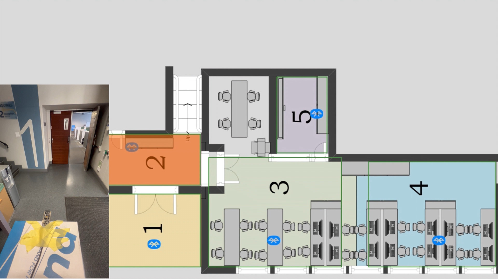
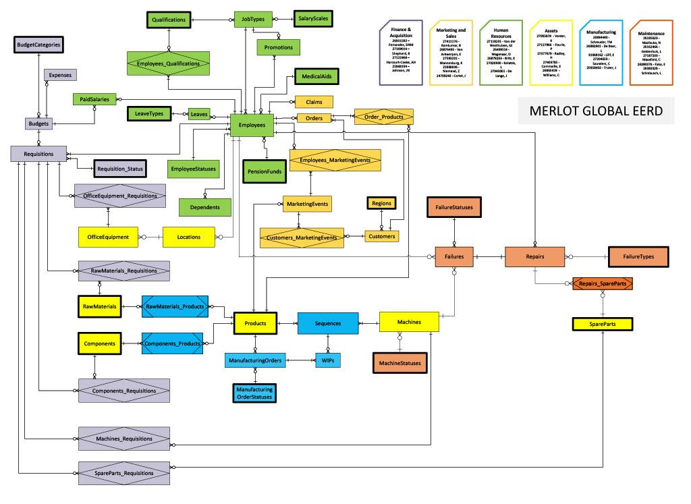

::: {.hero}
{.profile-pic}

# Emmanuel Fako
Industrial Engineer

::: {.subtitle}
Data-driven operations and process improvement, turning complexity into clarity.
:::

::: {.hero-actions}
[View My Work](portfolio.qmd){.btn-primary}
[LinkedIn](https://linkedin.com/in/emmanuel-fako-773180364){.btn-secondary}
:::
:::

::: {.section}
## About Me {.section-title}

I am a final-year BEng Industrial Engineering student at Stellenbosch University (completing in 2026), working at the intersection of operations improvement, software systems, and data analytics.

Across two factory internships and a range of engineering builds, my work spans production-floor Lean and OEE turnarounds, ESP32-based IoT telemetry and machine learning pipelines, relational MS SQL Server and C# .NET enterprise systems, and custom automation tools.

## Featured Work {.section-title}

Selected builds across embedded IoT, enterprise databases, and manufacturing operations.

::: {.featured-grid}

::: {.project-card}

::: {.project-card-body}
### [Final Year Project: BLESmart - Indoor Localisation & Occupancy Detection](projects/blesmart.qmd)

::: {.project-tags}
[Final Year Project]{.tag} [IoT & ESP32]{.tag} [Python]{.tag} [Machine Learning]{.tag} [Node-RED & MQTT]{.tag} [InfluxDB & Grafana]{.tag}
:::

Designed and validated a privacy-preserving Bluetooth Low Energy (BLE) pipeline using an ESP32-C6, MQTT, Node-RED, InfluxDB, and Grafana to track multi-room movement and estimate live lecture hall attendance.

[Read more →](projects/blesmart.qmd){.project-link}
:::
:::

::: {.project-card}

::: {.project-card-body}
### [Enterprise Resource Planning: Industrial Maintenance & Asset Management System](projects/maintenance-erp.qmd)

::: {.project-tags}
[Enterprise Systems]{.tag} [MS SQL Server]{.tag} [C# .NET]{.tag} [Database Architecture]{.tag}
:::

Architected an end-to-end ERP maintenance subsystem for manufacturing operations, integrating MS SQL Server relational modeling with a C# .NET desktop application across 9 core maintenance events and executive KPIs.

[Read more →](projects/maintenance-erp.qmd){.project-link}
:::
:::

::: {.project-card}

::: {.project-card-body}
### [Internship 2025: Dizani x Coricraft x Beekman - OEE Optimization & Digital Tracking](projects/dizani-2025.qmd)

::: {.project-tags}
[Internship]{.tag} [OEE]{.tag} [LEAN]{.tag} [Process Improvement]{.tag}
:::

Led process optimization initiatives at Coricraft and Beekman Canopies, digitizing performance tracking and driving laminating team OEE from 72% to over 90%.

[Read more →](projects/dizani-2025.qmd){.project-link}
:::
:::

:::

::: {.btn-row}
[Explore All 10 Projects →](portfolio.qmd){.btn-secondary}
:::

## Experience {.section-title}

::: {.timeline}

::: {.timeline-item}
::: {.timeline-header}
### Industrial Engineering Intern
[Dizani Consulting · Beekman Canopy Division]{.timeline-org}
[Jan 2025]{.timeline-date}
:::

- Conducted time studies on a fiberglass canopy laminating line to establish production baselines and isolate bottlenecks.
- Applied Lean Manufacturing and Value Stream Mapping (VSM) alongside workstation improvements to eliminate idle wait time.
- Contributed to raising Overall Equipment Effectiveness (OEE) from 72% to over 90%, formally recognised by site management.
- Established standardized performance metrics and visual tracking boards to sustain output gains.
:::

::: {.timeline-item}
::: {.timeline-header}
### Industrial Engineering Intern
[Dizani Consulting · Coricraft]{.timeline-org}
[Jan 2025]{.timeline-date}
:::

- Established standard cell times and implemented barcode-based workflow tracking into Dizani's Per4ma operations platform.
- Cleaned, validated, and structured large product datasets to enable reliable shop-floor ticketing and throughput reporting.
- Optimized CNC wood-panel nesting yields using AlphaCam software to reduce raw material scrap.
:::

::: {.timeline-item}
::: {.timeline-header}
### Industrial Engineering Intern
[Dizani Consulting · Alpine Furniture (Bravo Brands)]{.timeline-org}
[Jan 2024]{.timeline-date}
:::

- Executed time and motion studies in foam cutting and identified Fibre Department rack orientation as the primary FIFO buffer constraint.
- Redesigned the physical storage layout so racks could be accessed from both sides, increasing local buffer capacity toward the plant's 136-suite target.
- Replaced redundant racks in seaming with dedicated sorting tables to streamline downstream material handling.
:::

:::

## Education {.section-title}

::: {.edu-card}
### BEng Industrial Engineering · Stellenbosch University
[2022 - 2026 (Final Year Completion)]{.timeline-date}

Final-year thesis focused on privacy-preserving BLE edge telemetry and machine learning (**BLESmart**). Core coursework spans Systems & Information Systems Design, Data Analytics, Operations Research I & II, Simulation Modeling, Manufacturing Systems, Quality Management, Industrial Ergonomics, Production & Supply Chain Management, and Project Management.
:::

## Technical Skills & Tools {.section-title}

::: {.skills-grid}

::: {.skill-card}
### Systems, Software & Databases {.skill-card-title}
::: {.skill-tags}
[Python]{.skill-tag} [C# .NET]{.skill-tag} [MS SQL Server]{.skill-tag} [SQL]{.skill-tag} [R]{.skill-tag} [Embedded C++]{.skill-tag} [Visual Studio]{.skill-tag} [Git & Quarto]{.skill-tag}
:::
:::

::: {.skill-card}
### IoT, Telemetry & Analytics {.skill-card-title}
::: {.skill-tags}
[ESP32 / IoT]{.skill-tag} [Node-RED]{.skill-tag} [MQTT]{.skill-tag} [InfluxDB]{.skill-tag} [Grafana]{.skill-tag} [Machine Learning (WKNN / Clustering)]{.skill-tag} [OCR (EasyOCR)]{.skill-tag} [Engineering Statistics]{.skill-tag}
:::
:::

::: {.skill-card}
### Operations, Lean & Quality {.skill-card-title}
::: {.skill-tags}
[Lean Manufacturing]{.skill-tag} [OEE Analysis]{.skill-tag} [Value Stream Mapping]{.skill-tag} [Time & Motion Studies]{.skill-tag} [Facility Layout Design]{.skill-tag} [Quality Assurance]{.skill-tag} [5S & Per4ma]{.skill-tag}
:::
:::

::: {.skill-card}
### Engineering, CAD & Management {.skill-card-title}
::: {.skill-tags}
[Autodesk Inventor]{.skill-tag} [Operations Research]{.skill-tag} [Simulation Modeling]{.skill-tag} [MS Project (EVA)]{.skill-tag} [Advanced Excel & VBA]{.skill-tag} [Supply Chain (S&OP / TCO)]{.skill-tag} [AlphaCam Nesting]{.skill-tag}
:::
:::

:::

## Certifications {.section-title}

Verified credentials across project management, relational SQL querying, and supply chain strategy:

::: {.cert-grid}

::: {.cert-card}
### Foundation Certificate in Project Management (ICB4)
::: {.cert-meta}
[IPMA South Africa]{.cert-issuer}
[2025]{.cert-year}
:::
Internationally benchmarked project planning, risk control, and stakeholder delivery standard.
:::

::: {.cert-card}
### Intro & Advanced SQL
::: {.cert-meta}
[Kaggle]{.cert-issuer}
[2026]{.cert-year}
:::
Relational querying, window functions, nested joins, and query optimization for analytics pipelines.
:::

::: {.cert-card}
### End-to-End Supply Chain Excellence
::: {.cert-meta}
[Inchainge]{.cert-issuer}
[2024]{.cert-year}
:::
Cross-functional S&OP decision-making across purchasing, inventory, operations, and ROI alignment.
:::

:::

::: {.btn-row style="margin-top: 1.5rem;"}
[View All Certificates & Credentials →](certifications.qmd){.btn-primary}
:::
:::
