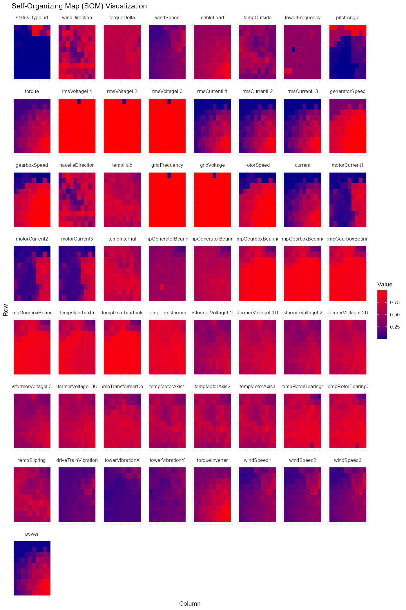
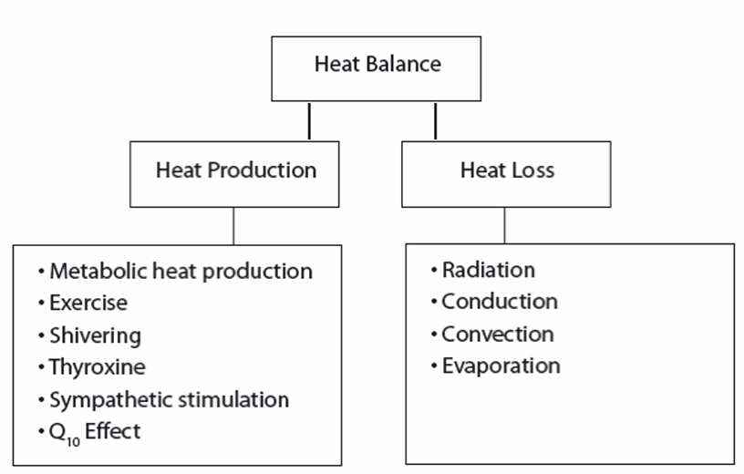
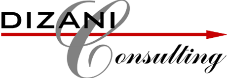
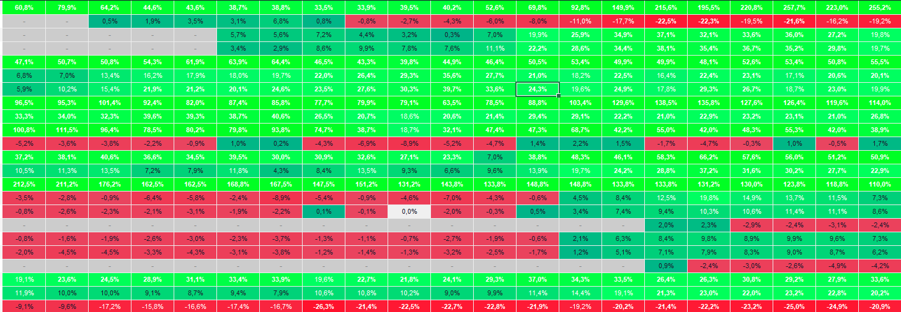

::: {.section}
# Portfolio {.section-title}
A selection of academic and professional work. 

::: {.project-grid}

::: {.project-card}

::: {.project-card-body}
### Data Analytics: Wind Turbine Operational Analysis & Clustering
[Varsity]{.tag} [Data Analytics]{.tag} [R]{.tag} [Clustering]{.tag}

Segmented 60-feature turbine sensor data into 3 operational clusters using SOM and K-Means, enabling predictive maintenance decisions.

[Read more →](projects/wind-turbine.qmd)
:::
:::

::: {.project-card}

::: {.project-card-body}
### Supply Chain Strategy: The Fresh Connection
[Varsity]{.tag} [Supply Chain]{.tag} [Purchasing]{.tag} [Data Analysis]{.tag} [Optimization]{.tag}

Fulfilled the role of Purchasing Manager for a massive simulated fruit juice company, executing an efficiency-driven strategy across 6 rounds to achieve an 80% final grade and a 5th-place finish.

[Read more →](projects/fresh-connection.qmd)
:::
:::

::: {.project-card}

::: {.project-card-body}
### Ergonomics & Thermal Stress Analysis
[Varsity]{.tag} [Ergonomics]{.tag} [First Principles]{.tag} [ECSA GA2]{.tag} [Methodology]{.tag}

Demonstrated the application of scientific and engineering knowledge from first principles to solve a complex workplace thermal stress problem using custom instrumentation and ergonomic modeling.

[Read more →](projects/thermal-stress.qmd)
:::
:::

::: {.project-card}

::: {.project-card-body}
### Project Management: Automated Smart Distribution Warehouse
[Varsity]{.tag} [Project Management]{.tag} [MS Project]{.tag} [Resource Optimization]{.tag} [Risk]{.tag}

Led the scheduling, baseline architecture, and resource strategy for a 12-period Project Management simulation, securing a 1st-place cohort finish.

[Read more →](projects/takealot-warehouse.qmd)
:::
:::

::: {.project-card}

::: {.project-card-body}
### Internship 2025: Dizani x Coricraft x Beekman - OEE Optimization & Digital Tracking
[Internship]{.tag} [OEE]{.tag} [LEAN]{.tag} [Process Improvement]{.tag}

Led process optimization initiatives at Coricraft and Beekman Canopies, digitizing performance tracking and driving laminating team OEE from 72% to over 90%.

[Read more →](projects/dizani-2025.qmd)
:::
:::

::: {.project-card}

::: {.project-card-body}
### Internship 2024: Dizani x Alpine - LEAN Implementation & Layout Design
[Internship]{.tag} [LEAN]{.tag} [Time Studies]{.tag} [Facility Layout]{.tag} [Process Improvement]{.tag}

Implemented LEAN methodologies and redesigned the Fibre Department's material stock buffer, significantly increasing local storage capacity and advancing the factory toward its 136-suite target.

[Read more →](projects/dizani-2024.qmd)
:::
:::

::: {.project-card}

::: {.project-card-body}
### EasyEquities Portfolio Tracker
[Python]{.tag} [C# .NET]{.tag} [OCR]{.tag} [Excel Automation]{.tag} [Finance]{.tag} [Machine Learning]{.tag}

Built a C# desktop application and Python script to extract portfolio data from screenshots using OCR(Optical Character Recognition) and automatically update a custom Excel tracking dashboard.

[Read more →](projects/ee-tracker.qmd)
:::
:::

:::
:::