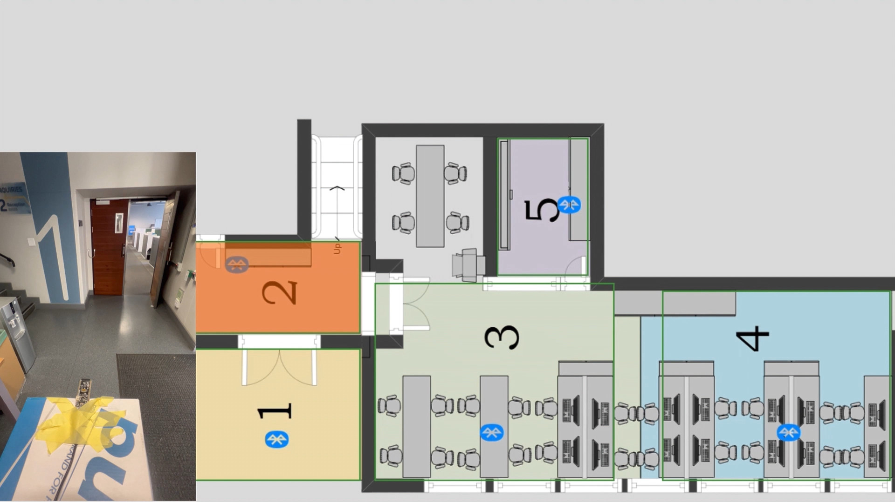
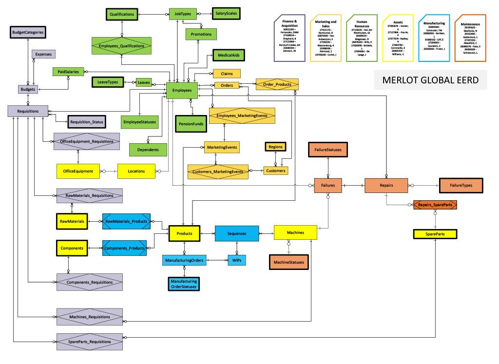
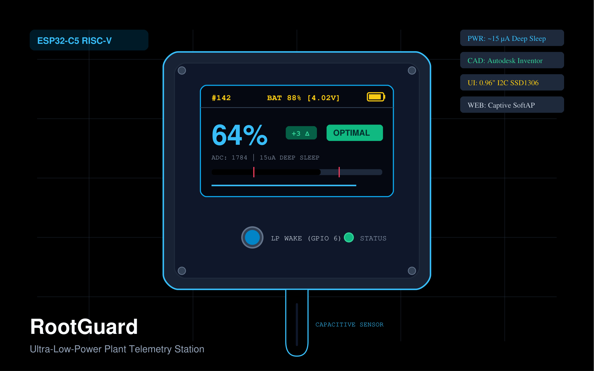
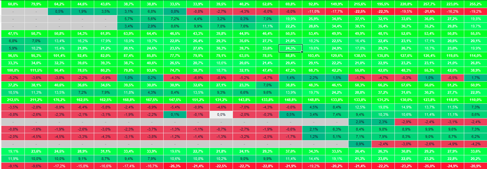
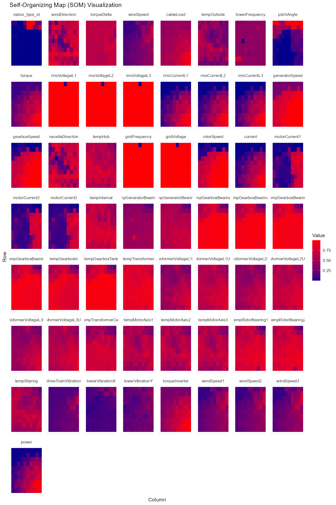
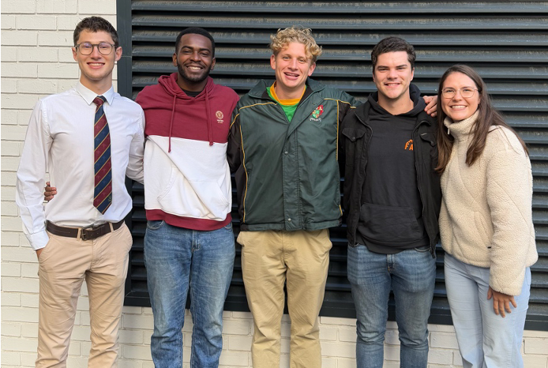
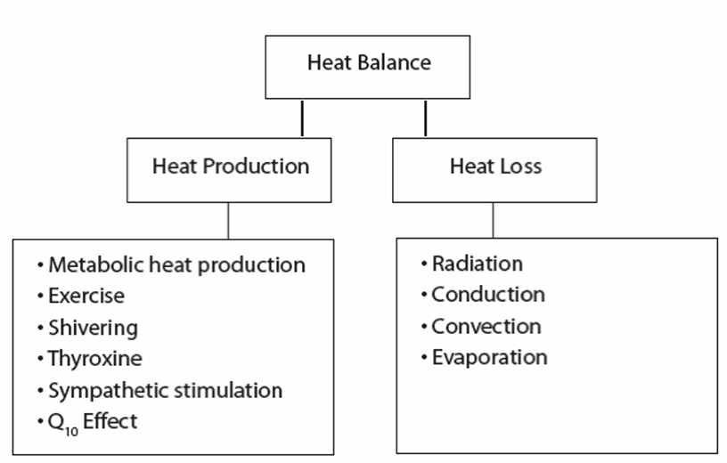

::: {.section}
# Portfolio {.section-title}
Selected academic, industrial internship, and personal engineering projects.

```{=html}
<div class="filter-bar" role="group" aria-label="Filter projects by category">
  <button type="button" class="filter-btn active" data-filter="all" aria-pressed="true">All (10)</button>
  <button type="button" class="filter-btn" data-filter="systems" aria-pressed="false">Systems &amp; Software</button>
  <button type="button" class="filter-btn" data-filter="iot" aria-pressed="false">IoT &amp; Hardware</button>
  <button type="button" class="filter-btn" data-filter="operations" aria-pressed="false">Operations &amp; Internships</button>
</div>
```

::: {.project-grid}

::: {.project-card data-categories="iot systems"}
[](projects/blesmart.qmd)

::: {.project-card-body}
### [Final Year Project: BLESmart - Indoor Localisation & Occupancy Detection](projects/blesmart.qmd)

::: {.project-tags}
[Final Year Project]{.tag} [IoT & ESP32]{.tag} [Python]{.tag} [Machine Learning]{.tag} [Node-RED & MQTT]{.tag} [InfluxDB & Grafana]{.tag}
:::

Designed and validated a privacy-preserving Bluetooth Low Energy (BLE) pipeline using an ESP32-C6, MQTT, Node-RED, InfluxDB, and Grafana to track multi-room indoor movement and estimate live lecture hall attendance.

[Read more →](projects/blesmart.qmd){.project-link}
:::
:::

::: {.project-card data-categories="systems"}
[](projects/maintenance-erp.qmd)

::: {.project-card-body}
### [Enterprise Resource Planning: Industrial Maintenance & Asset Management System](projects/maintenance-erp.qmd)

::: {.project-tags}
[Enterprise Systems]{.tag} [MS SQL Server]{.tag} [C# .NET]{.tag} [Database Architecture]{.tag} [Systems Engineering]{.tag}
:::

Architected an end-to-end ERP maintenance subsystem for manufacturing operations, integrating MS SQL Server relational modeling with a C# .NET desktop application across 9 core maintenance events and executive KPIs.

[Read more →](projects/maintenance-erp.qmd){.project-link}
:::
:::

::: {.project-card data-categories="operations"}
[](projects/dizani-2025.qmd)

::: {.project-card-body}
### [Internship 2025: Dizani x Coricraft x Beekman - OEE Optimization & Digital Tracking](projects/dizani-2025.qmd)

::: {.project-tags}
[Internship]{.tag} [OEE]{.tag} [LEAN]{.tag} [Process Improvement]{.tag}
:::

Led process optimization initiatives at Coricraft and Beekman Canopies, digitizing performance tracking and driving laminating team OEE from 72% to over 90%.

[Read more →](projects/dizani-2025.qmd){.project-link}
:::
:::

::: {.project-card data-categories="iot"}
[](projects/rootguard.qmd)

::: {.project-card-body}
### [RootGuard: IoT Soil Moisture Monitor](projects/rootguard.qmd)

::: {.project-tags}
[Personal Project]{.tag} [ESP32-C5]{.tag} [Autodesk Inventor]{.tag} [Soldering & Electronics]{.tag} [C++]{.tag}
:::

A battery-powered soil monitor built to keep my Monstera alive. Designed a 3D-printed case in Autodesk Inventor, learned to solder while tracking down hardware bugs, and wrote low-power ESP32 firmware with an on-demand web dashboard.

[Read more →](projects/rootguard.qmd){.project-link}
:::
:::

::: {.project-card data-categories="systems"}
[](projects/ee-tracker.qmd)

::: {.project-card-body}
### [EasyEquities Portfolio Tracker](projects/ee-tracker.qmd)

::: {.project-tags}
[Python]{.tag} [C# .NET]{.tag} [OCR]{.tag} [Excel Automation]{.tag} [Finance]{.tag}
:::

Built a C# desktop application and Python script to extract portfolio data from screenshots using OCR (Optical Character Recognition) and automatically update a custom Excel tracking dashboard.

[Read more →](projects/ee-tracker.qmd){.project-link}
:::
:::

::: {.project-card data-categories="systems"}
[](projects/wind-turbine.qmd)

::: {.project-card-body}
### [Data Analytics: Wind Turbine Operational Analysis & Clustering](projects/wind-turbine.qmd)

::: {.project-tags}
[Varsity]{.tag} [Data Analytics]{.tag} [R]{.tag} [Clustering]{.tag}
:::

Segmented 60-feature turbine sensor data into 3 operational clusters using SOM and K-Means, enabling predictive maintenance decisions.

[Read more →](projects/wind-turbine.qmd){.project-link}
:::
:::

::: {.project-card data-categories="operations"}
[](projects/takealot-warehouse.qmd)

::: {.project-card-body}
### [Project Management: Automated Smart Distribution Warehouse](projects/takealot-warehouse.qmd)

::: {.project-tags}
[Varsity]{.tag} [Project Management]{.tag} [MS Project]{.tag} [Resource Optimization]{.tag} [Risk]{.tag}
:::

Led the scheduling, baseline architecture, and resource strategy for a 12-period Project Management simulation, securing a 1st-place cohort finish.

[Read more →](projects/takealot-warehouse.qmd){.project-link}
:::
:::

::: {.project-card data-categories="operations"}
[](projects/fresh-connection.qmd)

::: {.project-card-body}
### [Supply Chain Strategy: The Fresh Connection](projects/fresh-connection.qmd)

::: {.project-tags}
[Varsity]{.tag} [Supply Chain]{.tag} [Purchasing]{.tag} [Data Analysis]{.tag} [Optimization]{.tag}
:::

Fulfilled the role of Purchasing Manager for a massive simulated fruit juice company, executing an efficiency-driven strategy across 6 rounds to achieve an 80% final grade and a 5th-place finish.

[Read more →](projects/fresh-connection.qmd){.project-link}
:::
:::

::: {.project-card data-categories="operations"}
[](projects/thermal-stress.qmd)

::: {.project-card-body}
### [Ergonomics & Thermal Stress Analysis](projects/thermal-stress.qmd)

::: {.project-tags}
[Varsity]{.tag} [Ergonomics]{.tag} [First Principles]{.tag} [ECSA GA2]{.tag} [Methodology]{.tag}
:::

Demonstrated the application of scientific and engineering knowledge from first principles to solve a complex workplace thermal stress problem using custom instrumentation and ergonomic modeling.

[Read more →](projects/thermal-stress.qmd){.project-link}
:::
:::

::: {.project-card data-categories="operations"}
[](projects/dizani-2024.qmd)

::: {.project-card-body}
### [Internship 2024: Dizani x Alpine - LEAN Implementation & Layout Design](projects/dizani-2024.qmd)

::: {.project-tags}
[Internship]{.tag} [LEAN]{.tag} [Time Studies]{.tag} [Facility Layout]{.tag} [Process Improvement]{.tag}
:::

Implemented LEAN methodologies and redesigned the Fibre Department's material stock buffer, significantly increasing local storage capacity and advancing the factory toward its 136-suite target.

[Read more →](projects/dizani-2024.qmd){.project-link}
:::
:::

:::

```{=html}
<script>
document.addEventListener("DOMContentLoaded", function () {
  var buttons = document.querySelectorAll(".filter-btn");
  var cards = document.querySelectorAll(".project-grid .project-card");
  if (!buttons.length || !cards.length) return;

  buttons.forEach(function (btn) {
    btn.addEventListener("click", function () {
      var filter = btn.getAttribute("data-filter") || "all";

      buttons.forEach(function (b) {
        var active = b === btn;
        b.classList.toggle("active", active);
        b.setAttribute("aria-pressed", active ? "true" : "false");
      });

      cards.forEach(function (card) {
        var cats = (card.getAttribute("data-categories") || "").split(/\s+/);
        var show = filter === "all" || cats.indexOf(filter) !== -1;
        card.classList.toggle("is-hidden", !show);
      });
    });
  });
});
</script>
```
:::
