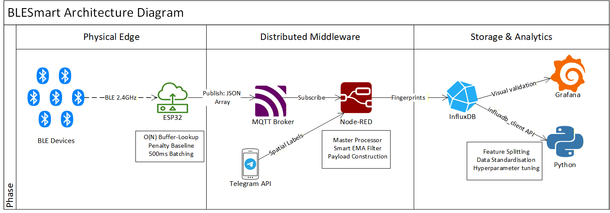
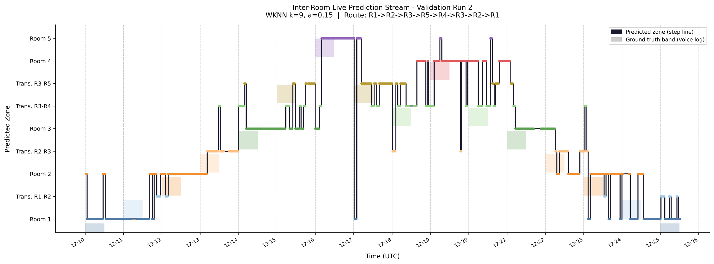

::: {.section}

[← Back to Portfolio](../portfolio.qmd)

# BLESmart: Indoor Localisation & Occupancy Detection {.section-title}
**Context:** Industrial Project 498 (Final Year Project, 2026) · IoT, Edge Computing & Machine Learning

A privacy-preserving Bluetooth Low Energy (BLE) telemetry system built to track multi-room indoor movement and estimate live classroom attendance without cameras or intrusive infrastructure.

---

### The Problem
* Satellite GPS signals degrade indoors, while conventional indoor tracking systems (optical cameras, RFID gates, or Ultra-Wideband anchors) are costly to scale across university campuses and introduce privacy concerns.
* Everyday 2.4 GHz Bluetooth Low Energy (BLE) signals offer a low-cost alternative using fixed reference beacons and the mobile devices people already carry, but raw indoor signal strength fluctuates heavily due to wall reflections and human body absorption.
* Counting nearby Bluetooth broadcasts directly inflates visitor numbers by 4 to 6 times per hour because modern phones rotate their MAC addresses every 10 to 15 minutes for privacy, alongside constant background noise from static classroom equipment such as projectors and printers.

### The Approach
* **Three-Tier IoT Telemetry Pipeline:** Engineered an end-to-end architecture connecting an ESP32-C6 scanner and five BLE reference beacons to an MQTT broker, Node-RED middleware, InfluxDB time-series storage, and live Grafana floor-plan dashboards. Implemented onboard packet buffering and 500 ms JSON batching on the ESP32-C6 to prevent single-antenna Wi-Fi and Bluetooth drops, maintaining a ~398 ms live inference latency.
* **Live Spatial Fingerprinting (`LabelTron`):** Built a custom Telegram bot integrated with Node-RED to inject live spatial labels during field calibration, recording over 9,000 labelled fingerprints across a 21-zone open-plan space (3 x 3 m grid) and a five-room complex with four doorway transition zones.
* **Signal Conditioning & Classification:** Designed a custom "Smart EMA" (Exponential Moving Average) filter in Node-RED that smooths noisy signal swings while snapping cleanly on beacon dropouts and recoveries. Benchmarked KNN, Weighted KNN, and Random Forest models in Python (`scikit-learn`) across 210 parameter combinations, deploying Weighted KNN so new rooms can be appended to the reference map without retraining.
* **POPIA-Aligned Occupancy Estimation:** Parsed public BLE protocol identifiers (Apple, Google/Android, and Samsung) alongside a signal-strength perimeter gate to separate active personal devices from static room hardware without MAC de-randomisation. Temporary identifiers were held strictly in volatile RAM and purged within 75 seconds so only anonymous integer headcounts were stored.
* **Live Stress Testing & Queue Optimization:** Validated the occupancy pipeline across live university lectures against manual headcounts. When a simultaneous 39-student lecture exit burst overwhelmed the ESP32's default 30-slot MQTT queue, traced the root cause, expanded buffer capacity to 150 slots, and added a 75-second Node-RED expiry watchdog so departure bursts cleared cleanly.

### The Outcome
* **Multi-Room & Zone Localisation:** Achieved **92.8% offline classification accuracy** across the five-room and doorway network and **80.4%** across the 21 open-plan zones (+10 percentage-point gain from the Smart EMA filter). During continuous live walk tests, physical walls provided clear signal separation, tracking the active room or doorway transition across **86.7% of live windows** (15 of 16 segments).
* **Anonymous Classroom Occupancy:** Rejected ~65% of static background radio noise and achieved an **R² of 0.97 offline** (MAE of 3.1 occupants) and **R² of 0.96 during live lecture validation**, accurately tracking real-time arrival and exit trends across sessions.
* **Scalable Campus Prototype:** Delivered a complete, low-cost hardware and analytics stack capable of supporting data-driven lecture venue allocation and demand-driven HVAC energy control.

> **Practical Impact:** Demonstrated that low-cost ESP32 edge nodes paired with targeted signal filtering and lightweight machine learning can deliver privacy-safe building analytics without cameras or high-cost tracking hardware.

::: {.case-actions}
[View Executive Summary (PDF) ↗](../images/blesmart/BLESmart-executive-summary.pdf){.btn-primary target="_blank"}
[Download Presentation Slides (.pptx)](../images/blesmart/BLESmart-presentation.pptx){.btn-secondary}
:::

---

### Project Visuals

**Live Multi-Room Walk-Test & Floor Plan Tracking**
*Live walkthrough moving from Room 2 through the doorway into Room 3, paired with the real-time predicted location on the floor plan.*

```{=html}
<video controls playsinline preload="none" poster="../images/blesmart/walkthrough.jpg" aria-label="BLESmart live doorway walk test" style="display:block;width:100%;max-width:860px;margin:1rem auto 2rem;border-radius:8px;border:1px solid var(--border);"><source src="../images/blesmart/walkthrough.mp4" type="video/mp4"></video>
```

**End-to-End Edge-to-Cloud Architecture**


**Inter-Room Live Trajectory Validation**


**Anonymous Classroom Occupancy Tracking**


::: {.case-nav}
::: {.case-nav-prev .is-disabled}
:::
::: {.case-nav-index}
[All Projects](../portfolio.qmd)
:::
::: {.case-nav-next}
[Next: Maintenance ERP →](maintenance-erp.qmd)
:::
:::

:::
