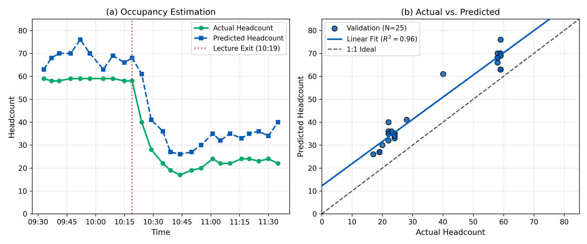

::: {.section}

[← Back to Portfolio](../portfolio.qmd)

# BLESmart {.section-title}

**Indoor localisation and classroom occupancy estimation**  
BEng Industrial Engineering · Stellenbosch University · Final-year project, 2026

I wanted to see what a university could learn about how its rooms are used from the Bluetooth signals already present. I built two experiments around an ESP32 scanner. In one, I carried it between fixed beacons to predict my location. In the other, I left it in a classroom and compared nearby device activity with the number of people I counted by hand.

```{=html}
<video controls playsinline preload="none" poster="../images/blesmart/walkthrough.jpg" aria-label="BLESmart live doorway walk test" style="display:block;width:100%;max-width:900px;border-radius:8px"><source src="../images/blesmart/walkthrough.mp4" type="video/mp4"></video>
```

*Live walk test. The camera view shows the route from Room 2 through the doorway into Room 3. The floor plan shows the predicted location.*

## Finding the right room

Five beacons gave each location a characteristic pattern of signal strengths. I recorded labelled examples, then used weighted nearest neighbours to match new readings to familiar patterns. I tested the same approach at two scales: 21 open-plan zones of 3 × 3 metres, and five rooms connected by four doorway transition zones.

| Test environment | Offline exact | Live exact | Live including adjacent zones |
|:--|--:|--:|--:|
| Open-plan zones | 80.41% | 24.9% | 67.7% |
| Rooms and doorways | 92.83% | 50.6% | 86.7% |


Walls helped distinguish rooms. Within the open-plan space, turning my body could change the signal enough to shift the prediction into the next zone. The walk test exposed a weakness in my evaluation: my offline split drew training and test samples from the same recordings. I would hold out entire runs in a repeat experiment.

## What happened when a lecture ended

For the occupancy experiment, I used Node-RED to filter nearby Bluetooth broadcasts, stored aggregate counts in InfluxDB, and compared them with manual headcounts. When 39 students left together, the device count stayed high. I traced the problem to the ESP32: more than 60 device timeouts arrived in a burst, and its 30-slot message queue lost departure events.

I increased the queue to 150 slots and added a 75-second expiry in Node-RED. The stale counts cleared. Across 25 live observations, the estimates followed changes in attendance but were still off by **11 people on average**. How many devices each person carried mattered even after the firmware fix.



## Project materials

[Executive summary (PDF)](../images/blesmart/BLESmart-executive-summary.pdf) · [Download the presentation (PowerPoint)](../images/blesmart/BLESmart-presentation.pptx)

:::
