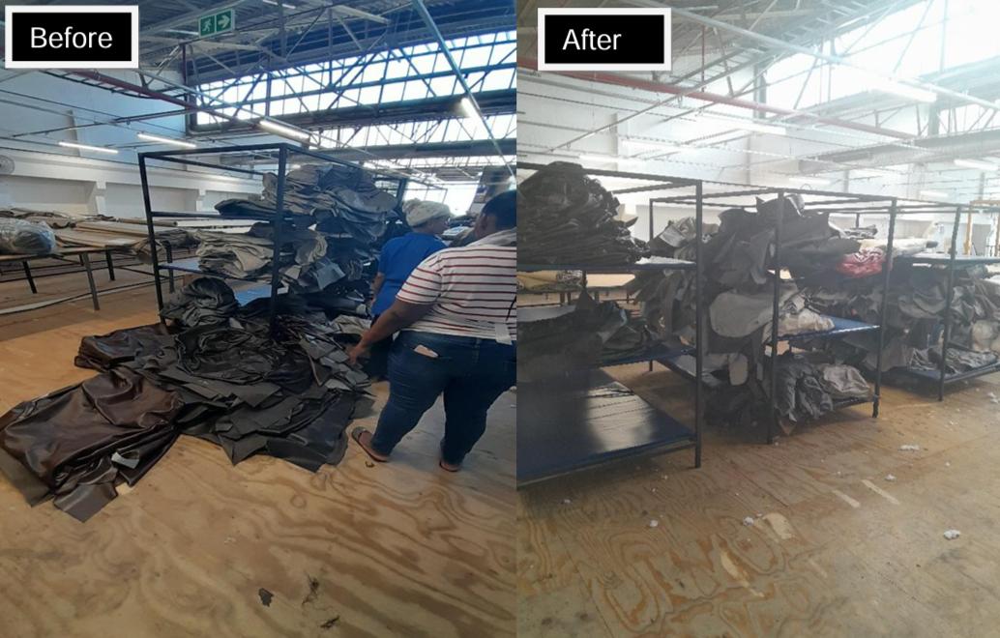
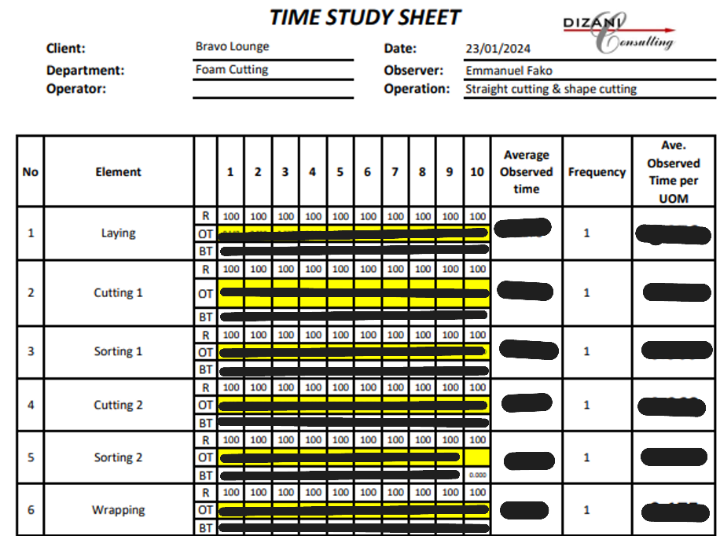

::: {.section}

[← Back to Portfolio](../portfolio.qmd)

# LEAN Implementation & Buffer Optimization {.section-title}
**Context:** Vacation Training 351 (2024) · Dizani Consulting & Bravo Brands

A foundational industrial engineering internship focused on time studies, waste elimination, and physical layout redesign.

---

### The Problem
* The Bravo Lounge division manufactured 45,000 pieces of furniture a month but suffered from underutilized storage areas and inefficient material flow. 
* The factory had a long-term operational goal to create a First-In-First-Out (FIFO) buffer capable of holding two days' worth of work (136 suites) spread across the bridge, the fibre department, and the foam cutting department.

### The Approach
* Conducted detailed time and motion studies in the foam cutting department to establish baseline standard times for the factory.
* Analyzed the physical layout of the Fibre Department, identifying that racks were only being utilized on one side due to poor spatial orientation.
* Executed a Phase 1 action plan to remove unused racks from the seaming department, replace them with sorting tables, and rotate the orientation of the remaining racks in the Fibre department to maximize accessibility.

### The Outcome
* Successfully reoriented the Fibre Department storage layout so both sides of the racks could be utilized, significantly increasing local storage capacity and ease of access.
* This first-phase implementation successfully moved the factory closer to its overarching 136-suite buffer target before the project was formally handed over at the completion of the internship.
* Earned a highly positive performance review, securing a return internship offer for the 2025 cycle.

> **Employer Testimonial:** *"Overall, Emmanuel was productive and enriching... His knowledge and skills acquired during this period will contribute positively to his academic and future career pursuits. Looking forward to round two!"* - T. Els, Dizani Consulting

---

[Vacation Training Certificate →](../images/vc24.pdf)

*Note on Confidentiality: Out of respect for client intellectual property and proprietary operations, specific process flowcharts, raw time study data, and internal software interfaces have been omitted or redacted from this public portfolio.*

### Project Visuals

**Continuous Improvement: Stock Buffer Optimization**

**Time & Motion Study Data Collection**

:::