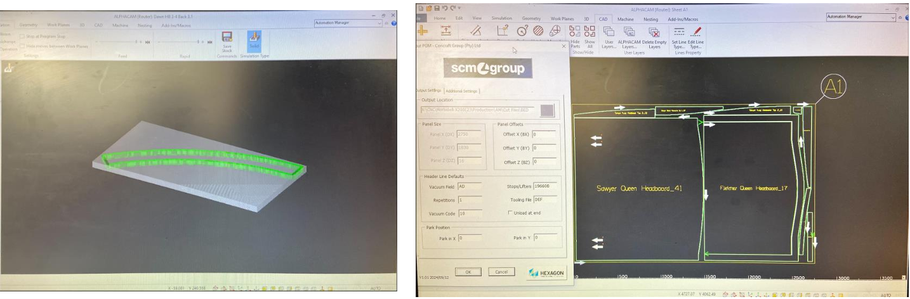

::: {.section}

[← Back to Portfolio](../portfolio.qmd)

# OEE Optimization & Digital Performance Tracking {.section-title}
**Context:** Vacation Training 451 (2025) · Dizani Consulting, Coricraft & Beekman Canopies

A high-impact process engineering internship focused on digitizing factory performance and driving Overall Equipment Effectiveness (OEE).

---

### The Problem
* Manufacturing plants at Coricraft and Beekman Canopies lacked real-time productivity tracking and suffered from unmeasured material flow bottlenecks. 
* The Beekman plant specifically needed a way to measure the critical laminating process output against target schedules.

### The Approach
* **Coricraft:** Set standard times for upholstery cells and integrated them into the Per4ma digital tracking system via a new barcode ticket system. Optimized CNC material yield using AlphaCam nesting software to group and cut wood parts with minimal waste.
* **Beekman Canopies:** Conducted time studies for the laminating process, mathematically incorporating a 15% rest allowance to account for factory heat and paint fumes. 
* Proposed physical process improvements to eliminate idle time, including additional tool-washing basins and mechanical lifting levers to reduce dependency on unavailable manual labor.

### The Outcome
* Directly contributed to driving the Overall Equipment Effectiveness (OEE) at the Beekman plant from 72% to over 90%.
* Enabled real-time, digital efficiency tracking for factory floor managers across multiple production lines.

> **Employer Testimonial:** *"This gentleman conducted himself to a level where Dizani will use him again and again. He did not just learn but contributed to the project at Beekman Canopies... Managed to take the team from 72% OEE into the 90% - Well done!!"* - T. Els, Dizani Consulting

---

[Vacation Training Certificate →](../images/vc25.pdf)

*Note on Confidentiality: Out of respect for client intellectual property and proprietary operations, specific process flowcharts, raw time study data, and internal software interfaces have been omitted or redacted from this public portfolio.*

### Project Visuals

**AlphaCam CNC Nesting & Material Optimization**

:::