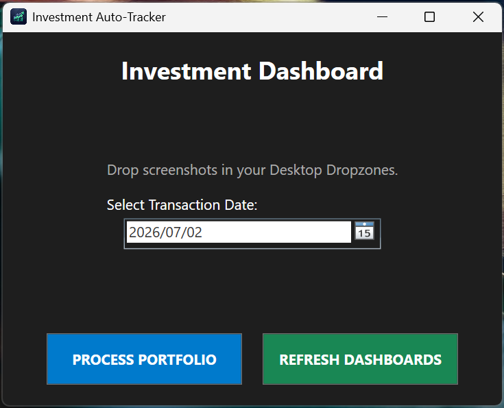

::: {.section}

[← Back to Portfolio](../portfolio.qmd)

# EasyEquities Portfolio Tracker {.section-title}
**Context:** Personal Project · Python, C# .NET, & OCR

A custom desktop application that extracts portfolio data from screenshots and automates Excel historical reporting.

---

### The Problem
* Updating weekly portfolio performance required manually typing balances, profit/loss, and percentages from EasyEquities into Excel.
* EasyEquities only provided current snapshots, making it difficult to track historical volatility, max drawdowns, or weekly returns over time.
* Managing multiple accounts (Tax-Free, ZAR, USD) and comparing live strategies to demo accounts required clicking through isolated tabs.

### The Approach
* **Application Architecture:** Built a desktop interface that triggers a Python data processing script via command-line execution.
* **Data Extraction:** Used Python's `easyocr` library to extract raw text from uploaded screenshots of the portfolio.
* **Data Cleaning & Parsing:** Wrote regular expressions (`re`) and coordinate-based logic (matching $y$-center and $x$-center bounding boxes) to reconstruct rows of financial data from unstructured image text.
* **Error Handling:** Implemented mathematical cross-validation to fix common OCR mistakes. For example, catching dropped negative signs by verifying absolute values against percentage returns, and writing custom handlers for comma/decimal misreads.
* **Excel Integration:** Used `pandas` and `numpy` to structure the cleaned data, and `openpyxl` to automatically overwrite and update the charts, tables, and heatmaps in the target Excel file.

### The Outcome
* **Automated Workflow:** Packaged the tool as a standalone `.exe` that takes a folder of screenshots as input and generates a fully updated Excel tracker with a single click.
* **Historical Tracking:** The Excel file automatically calculates and charts weekly standard deviation (volatility), max drawdowns, and weekly return distributions for each individual holding.
* **Account Comparison:** Built a feature to map and compare the performance of equivalent assets across live and demo accounts.
* **Currency Modeling:** Added a scenario tool to calculate total ZAR-equivalent risk exposure based on manual USD/ZAR exchange rate adjustments.

---

### Project Visuals

**Automated Python-Generated Excel Dashboard**
<iframe src="../images/ee_dashboard.pdf?v=3" width="100%" height="600px" style="border: 1px solid #e5e7eb; border-radius: 8px;"></iframe>

**Custom C# .NET Application Interface**

:::