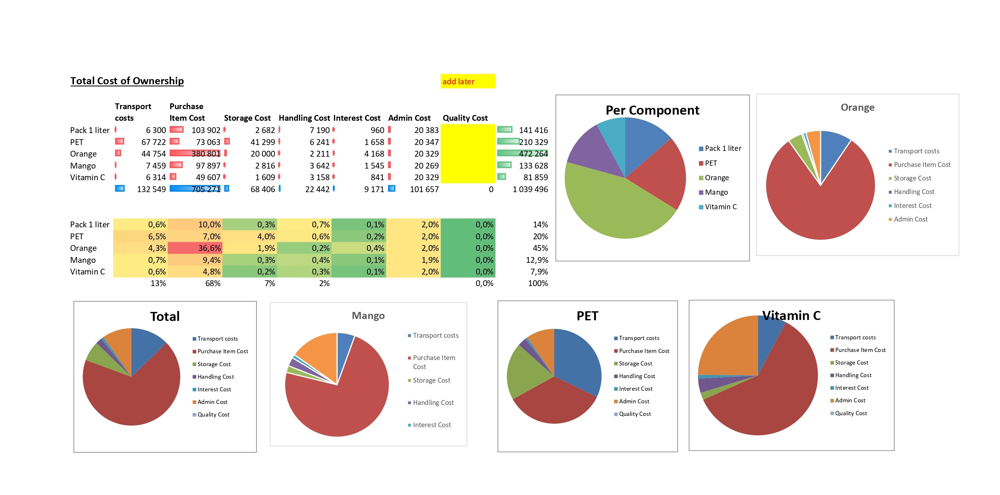
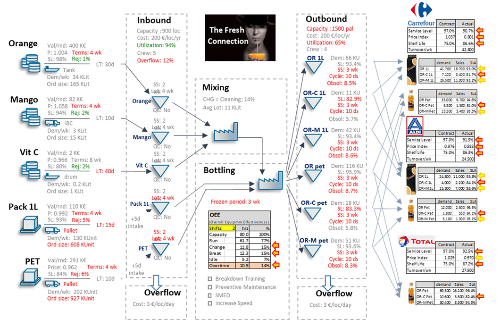
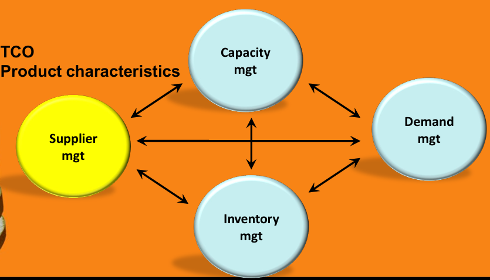

::: {.section}

[← Back to Portfolio](../portfolio.qmd)

# Supply Chain Strategy: The Fresh Connection {.section-title}
**Context:** Industrial Management 354 · Supply Chain Decision Simulation

---

### The Problem
- The objective was to turn around a failing fruit juice company from its demise over six successive simulation rounds.
- The simulation required balancing severe trade-offs across four interconnected functions: Purchasing, Operations, Sales, and Supply Chain.
- As the Purchasing lead, I was responsible for all decisions regarding suppliers and supplier agreements, directly impacting component availability and business profitability.

### The Approach
- Adopted a strict efficiency-focused strategy (as opposed to responsiveness) to ensure strategic fit and competitive alignment.
- Analyzed round-over-round data to quantify the Total Cost of Ownership (TCO) for raw materials, successfully modeling how acquisition costs played a big role in total cost, in Orange especially.
- Optimized component lot sizing and safety stock levels for critical materials (e.g., PET, Orange, Vitamin C) based on their specific product characteristics, volumes, and values.
- Collaborated cross-functionally to ensure purchasing decisions did not negatively constrain warehousing capacity or cause production bottlenecks.

### The Outcome
- Final project mark: **80%**, with a **ROI** of **38.31%**.
- Secured a **5th place** overall finish in the cohort ranking of 28 teams.
- Successfully aligned overarching business and supply chain strategies, translating them into tactical purchasing decisions.

> **Business Impact:** Demonstrated the ability to practically apply a Sales and Operations Planning (S&OP) approach, proving that rigorous, data-driven supplier selection and TCO management directly drive higher Return on Investment (ROI).

---

### Project Visuals

**Total Cost of Ownership (TCO) Analysis**

**Value Chain and Cross-Functional Supply Chain Trade-Offs**

::: {layout-ncol=2}

:::

**Supplier Summary and Decisions**

[Open Full Supplier Summary PDF ↗](../images/supplier_decison.pdf){.btn-secondary target="_blank" style="margin-left: 0; margin-bottom: 1rem;"}

<iframe src="../images/supplier_decison.pdf" width="100%" height="600px" style="border: 1px solid var(--border); border-radius: 8px;"></iframe>

:::
