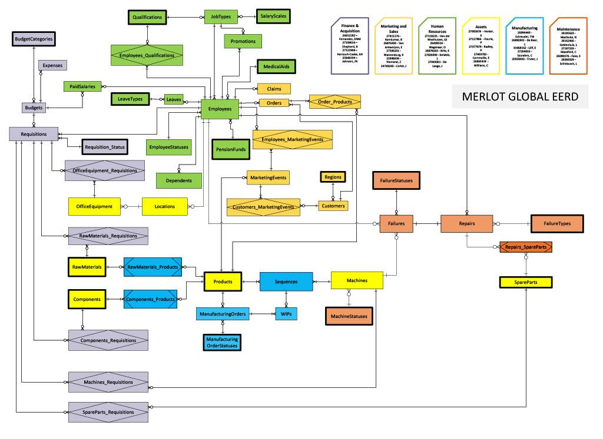
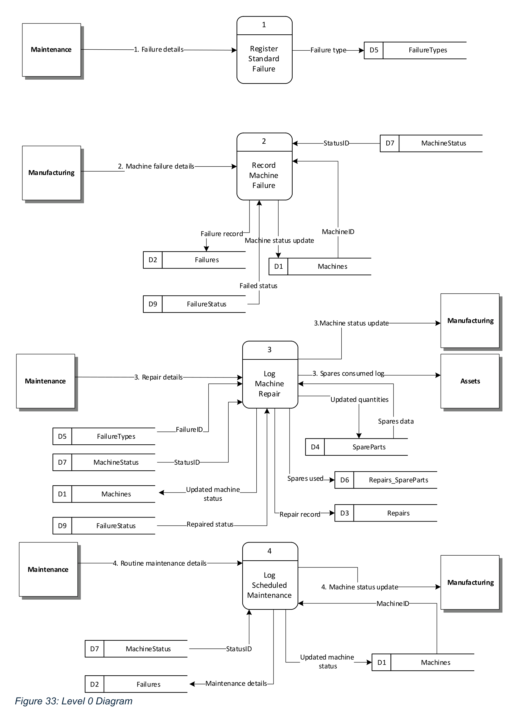
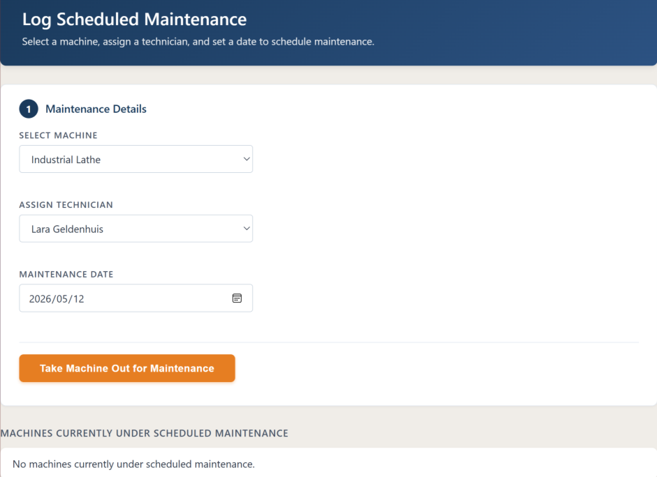
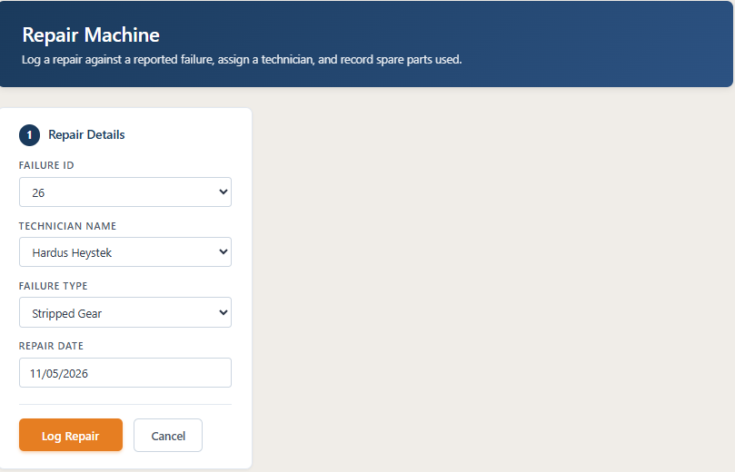
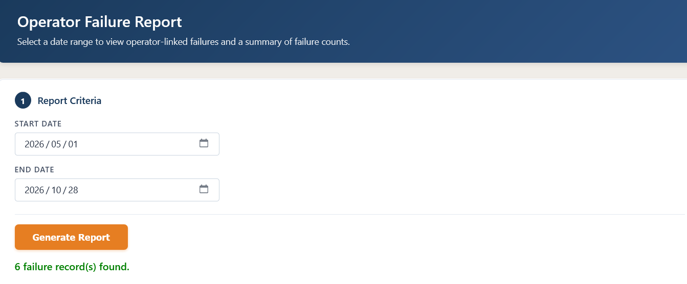
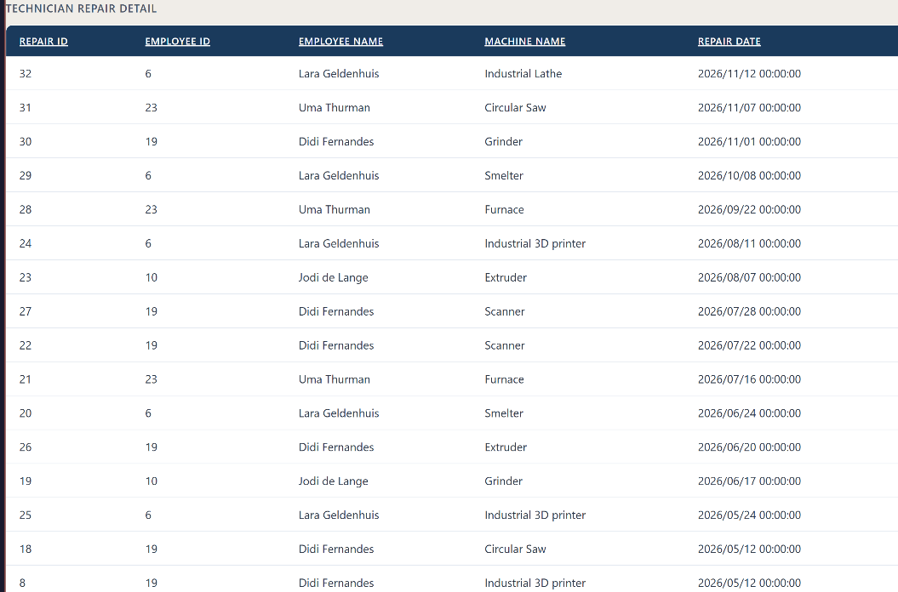

::: {.section}

[← Back to Portfolio](../portfolio.qmd)

# Enterprise Resource Planning: Industrial Maintenance & Asset Management System {.section-title}
**Context:** Information Systems 414 · Enterprise Architecture, Relational Database Modeling & C# .NET

An enterprise-grade maintenance management subsystem designed for manufacturing operations, integrating a normalized MS SQL Server relational database with a C# .NET application across 9 core operational business events and executive decision-support reporting.

---

### The Problem
* **Fragmented Tracking & Unscheduled Downtime:** Machine breakdowns and maintenance interventions were recorded across disparate paper and spreadsheet logs, delaying technician response times and leaving equipment downtime untracked.
* **Disconnected Spares & Inaccurate Costing:** Spare parts consumed during repairs were not automatically reconciled with warehouse inventory, causing stock-outs and distorted repair cost calculations.
* **Absence of Executive Decision Support:** Operations leadership lacked consolidated metrics (such as failure frequency by machine model, technician repair benchmarks, and scheduled vs reactive maintenance spend) needed for capital planning.

### The Approach & Systems Architecture
* **Systems Architecture & Technical Lead:** Spearheaded the data architecture within a collaborative team, taking primary ownership of the Global EERD, inter-module data dependencies, and complex multi-table transactional workflows. Guided team members across module boundaries to ensure schema consistency between production, maintenance, and inventory.
* **Normalized Relational Schema (3NF):** Designed the database in MS SQL Server, enforcing Third Normal Form (3NF) across all operational entities (`Machines`, `FailureTypes`, `Failures`, `Repairs`, `SpareParts`, `Repairs_SpareParts`, `ScheduledMaintenance`) with strict referential integrity, automated audit timestamps, and cascading constraints.
* **C# .NET Desktop Application & ADO.NET:** Developed a modular Windows Forms interface in Visual Studio 2022 with parameterised queries, input validation, and transactional business logic that decrements warehouse stock and calculates total repair costs upon work-order sign-off.

---

### Core Transactional Workflows

While the subsystem coordinates 9 operational events and 3 executive reports, four multi-entity transactional workflows formed the operational core:

* **Machine Breakdown Logging (MT2):** Floor operators log equipment failures with immediate status transition of `MachineStatus` to "Down", recording exact failure timestamps, symptom descriptions, and triggering technician dispatch.
* **Repair Execution & Spare Parts Reconciliation (MT3):** Technicians record labor hours, classify root causes against standard failure codes, and issue replacement components via the `Repairs_SpareParts` junction table. The transaction automatically decrements live stock and resets machine status to "Operational".
* **Preventative Maintenance Scheduling (MT4):** Planners configure recurring service intervals based on operational calendars or runtime thresholds, managing technician availability and minimizing planned shutdown conflicts.
* **Repair Cost Accounting Rollup (MT9):** Multi-table financial calculation summing technician labor expense (hours x hourly rate) and consumed parts expense (quantity x unit cost) grouped by standardized failure category for accounting and reliability engineering.

```{=html}
<details class="case-details">
  <summary>
    View Complete 12-Event Lifecycle Catalog (MT1-MT9 &amp; EM2, EM14, EM15)
  </summary>
  <div class="case-table-wrap">
    <table class="case-table">
      <thead>
        <tr>
          <th>Code</th>
          <th>Event Name</th>
          <th>Operational Trigger</th>
          <th>Key Tables</th>
          <th>Business Logic</th>
        </tr>
      </thead>
      <tbody>
        <tr><td>MT1</td><td>Register Failure Type</td><td>Engineering defines failure code</td><td><code>FailureTypes</code></td><td>Enforces unique error codes and records expected repair benchmarks.</td></tr>
        <tr><td>MT2</td><td>Record Machine Failure</td><td>Floor operator logs breakdown</td><td><code>Failures</code>, <code>Machines</code></td><td>Sets machine status to "Down" and alerts maintenance dispatch.</td></tr>
        <tr><td>MT3</td><td>Perform Machine Repair</td><td>Technician completes work order</td><td><code>Repairs</code>, <code>Repairs_SpareParts</code></td><td>Allocates spares, decrements inventory, and resets status to "Operational".</td></tr>
        <tr><td>MT4</td><td>Schedule Maintenance</td><td>Planner sets calendar service</td><td><code>ScheduledMaintenance</code></td><td>Validates shift availability and assigns qualified technicians.</td></tr>
        <tr><td>MT5</td><td>Add New Spares Item</td><td>Procurement enters new part</td><td><code>SpareParts</code></td><td>Initializes reorder thresholds and opening unit purchase cost.</td></tr>
        <tr><td>MT6</td><td>Reconcile Spare Stock</td><td>Stocktake count adjustment</td><td><code>SpareParts</code></td><td>Adjusts physical stock on hand and flags threshold breaches.</td></tr>
        <tr><td>MT7</td><td>Update Spare Unit Price</td><td>Supplier updates component pricing</td><td><code>SpareParts</code>, <code>Audit</code></td><td>Logs effective price dates while preserving historical work-order costs.</td></tr>
        <tr><td>MT8</td><td>Standard Failure Frequency</td><td>Reliability engineer queries trends</td><td><code>Failures</code>, <code>FailureTypes</code></td><td>Aggregates breakdown occurrences across selectable date windows.</td></tr>
        <tr><td>MT9</td><td>Repair Cost Calculation</td><td>Accountant requests cost rollup</td><td><code>Repairs</code>, <code>SpareParts</code></td><td>Rolls up labor and parts cost by failure code.</td></tr>
        <tr><td>EM2</td><td>Periodic Maintenance Cost</td><td>Executive quarterly cost review</td><td><code>Repairs</code>, <code>ScheduledMaint</code></td><td>Compares preventative investments vs reactive repair spend against budgets.</td></tr>
        <tr><td>EM14</td><td>Operator Failure Correlation</td><td>Operations reviews training needs</td><td><code>Failures</code>, <code>Employees</code></td><td>Cross-references breakdown timestamps with operator shift logs.</td></tr>
        <tr><td>EM15</td><td>Technician Repair Audit</td><td>Maintenance manager reviews crew</td><td><code>Repairs</code>, <code>Employees</code></td><td>Tracks actual repair durations against standard benchmark minutes.</td></tr>
      </tbody>
    </table>
  </div>
</details>
```

---

### Project Visuals & System Architecture

**Global Enterprise Entity-Relationship Diagram (EERD)**
*The complete relational schema modeling entity sets, recursive relationships, and foreign key constraints across the maintenance domain.*



---

**Level 0 Data Flow Diagram (DFD)**
*Process decomposition illustrating data pipelines, data stores (D1-D8), and inter-departmental data flows between Manufacturing, Maintenance, and Executive Management.*



---

**C# .NET Application & Executive Reporting Interfaces**

::: {layout-ncol=2}







:::

::: {.case-nav}
::: {.case-nav-prev}
[← Previous: BLESmart](blesmart.qmd)
:::
::: {.case-nav-index}
[All Projects](../portfolio.qmd)
:::
::: {.case-nav-next}
[Next: Dizani 2025 Internship →](dizani-2025.qmd)
:::
:::

:::
