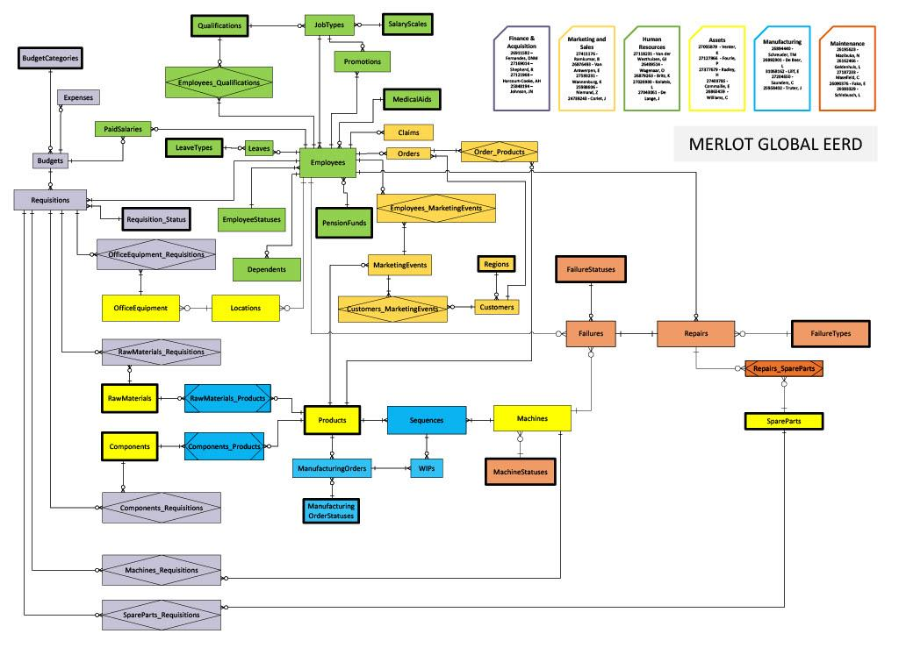
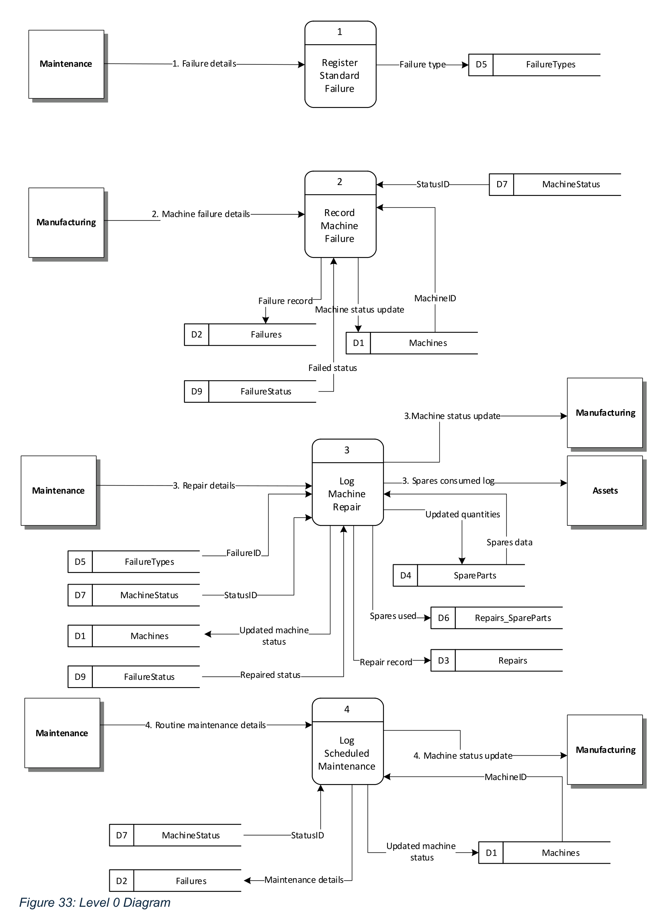
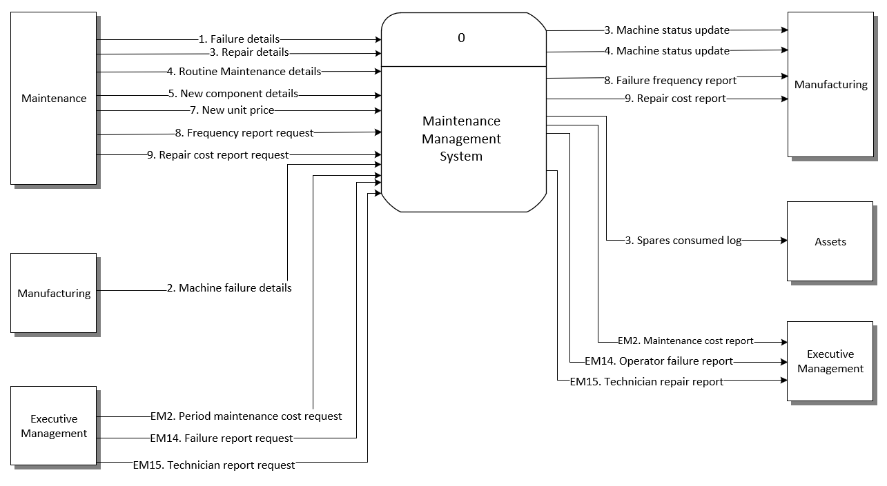
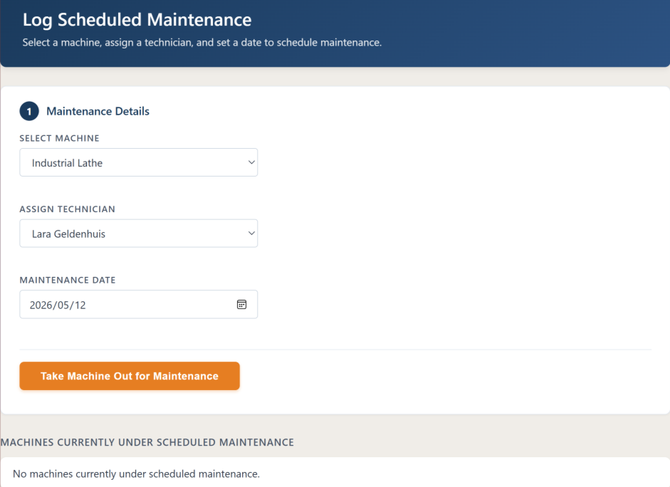
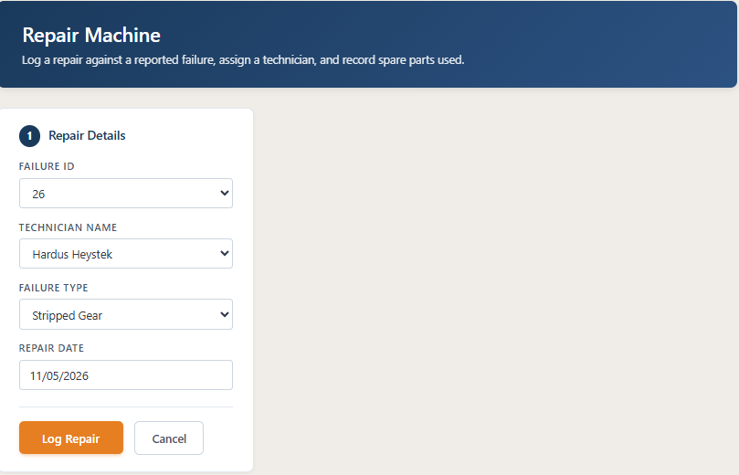
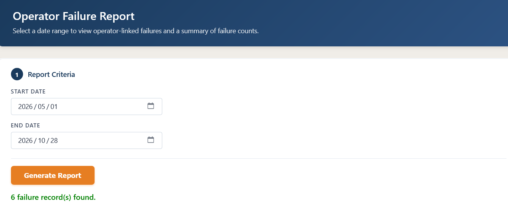
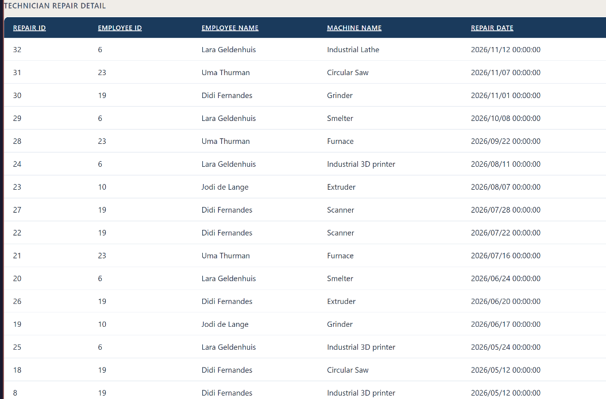

::: {.section}

[← Back to Portfolio](../portfolio.qmd)

# Enterprise Resource Planning: Industrial Maintenance & Asset Management System {.section-title}
**Context:** Information Systems 414 · Enterprise Architecture, Relational Database Modeling & C# .NET

An enterprise-grade maintenance management subsystem designed for manufacturing operations, integrating a normalized MS SQL Server relational database with a C# .NET application across 9 core operational business events and executive decision-support reporting.

---

### The Problem
* **Unscheduled Downtime & Communication Gaps:** Equipment failures in modern manufacturing facilities create severe bottlenecks. At Laatu Manufacturing Ultd., maintenance interventions, machine breakdown reporting, and technician assignments were handled across fragmented records, causing delayed repair responses and untracked machine downtime.
* **Disconnected Inventory & Cost Tracking:** Spare parts usage during emergency repairs was not automatically decremented from inventory, leading to unrecorded stock-outs, inaccurate unit repair cost calculations, and a lack of auditability.
* **Absence of Executive Decision Support:** Plant managers lacked aggregated operational metrics (such as recurring failure rates by machine model, technician labor efficiency, and scheduled vs reactive maintenance expenditure) required for long-term capital allocation and reliability engineering.

### The Approach & Systems Architecture
* **Systems Architecture & Technical Lead:** Served as the lead technical architect within a collaborative delivery team, taking primary ownership of the underlying relational database architecture (Global EERD), cross-module data dependencies, and the implementation of complex multi-table transactional events. Assisted team members across module boundaries to ensure data consistency between production, maintenance, and inventory workflows.
* **Relational Database Design (3NF):** Designed the comprehensive enterprise schema in MS SQL Server, enforcing Third Normal Form (3NF) across all operational entities (`Machines`, `MachineStatus`, `FailureTypes`, `Failures`, `Repairs`, `SpareParts`, `Repairs_SpareParts`, and `ScheduledMaintenance`). Configured primary/foreign key constraints, audit logging, and referential integrity to prevent orphan repair logs or negative inventory states.
* **Process Modeling & Data Flow Architecture:** Formulated formal Context Diagrams and Level 0 Data Flow Diagrams (DFDs) decomposing the maintenance lifecycle into discrete, event-driven processes. Defined rigorous data dictionaries and state transition boundaries for preventative servicing and breakdown interventions.
* **C# .NET Desktop Application:** Developed a modular Windows Forms interface in Microsoft Visual Studio, connecting directly to the MS SQL Server backend via ADO.NET. Built structured data-entry forms with parameterised queries to prevent SQL injection, enforced input validation (e.g., date-time logic, numeric hour verification), and dynamic cascading dropdowns for equipment and failure codes.
* **Automated Cost & Inventory Reconciliation:** Engineered backend transactional logic that automatically calculates total repair cost (technician hourly rates multiplied by repair duration plus consumed spare parts unit prices) and decrements warehouse stock upon work order sign-off.

---

### Core Business Events & Logic Matrix

The maintenance subsystem coordinates 9 operational events and 3 executive management reporting events across the manufacturing lifecycle:

| Event Code | Event Name | Operational Trigger | Database Tables Affected | Business Logic & Integrity Constraints |
|:---|:---|:---|:---|:---|
| **MT1** | Register New Failure Type | Engineering creates new standardized error code | `FailureTypes` | Validates uniqueness of failure code and records standard expected repair duration to baseline technician performance. |
| **MT2** | Record Machine Failure | Floor operator logs equipment breakdown | `Failures`, `Machines`, `MachineStatus` | Automatically flags machine status to "Down", records exact failure timestamp, logs reported symptoms, and alerts maintenance dispatch. |
| **MT3** | Perform Machine Repair & Spares Issue | Technician completes physical machine repair | `Repairs`, `Repairs_SpareParts`, `SpareParts`, `Machines` | Captures labor hours, root-cause failure classification, and allocated spare parts with quantities; automatically updates inventory and recalculates machine status to "Operational". |
| **MT4** | Schedule Preventative Maintenance | Maintenance planner sets calendar service | `ScheduledMaintenance`, `Machines` | Validates service schedules against operational shifts, assigns qualified technicians, and flags upcoming planned maintenance shutdowns. |
| **MT5** | Add New Maintenance Component | Procurement registers new replacement part | `SpareParts` | Initializes component catalog entry with part number, manufacturer specifications, minimum reorder thresholds, and opening unit cost. |
| **MT6** | Reconcile Spare Inventory Levels | Stock adjustment or physical inventory count | `SpareParts` | Adjusts physical stock on hand, checks for inventory threshold breaches, and triggers reorder notifications. |
| **MT7** | Update Spare Unit Price | Supplier updates replacement component pricing | `SpareParts`, `SpareParts_Audit` | Logs effective date of price adjustments while preserving historical cost snapshots for previously completed work orders. |
| **MT8** | Standard Failure Frequency Analysis | Reliability engineer queries failure trends | `Failures`, `FailureTypes` | Aggregates breakdown occurrences by equipment category and failure code across user-specified date ranges to isolate recurring root causes. |
| **MT9** | Repair Cost Calculation by Failure Type | Plant accountant requests failure financial rollup | `Repairs`, `Repairs_SpareParts`, `SpareParts`, `Employees` | Sums technician labor expense (hours × hourly rate) and consumed parts expense (quantity × unit cost) grouped by standard failure category. |
| **EM2** | Maintenance Expenditure per Fiscal Period | Executive management quarterly cost review | `Repairs`, `SpareParts`, `ScheduledMaintenance` | Compares preventative maintenance investments versus reactive breakdown costs against allocated departmental budgets. |
| **EM14** | Operator Failure Exposure Analysis | Plant management assesses training needs | `Failures`, `Machines`, `Employees` | Cross-references operator shift rosters with breakdown timestamps to determine if specific failure modes correlate with operator shifts. |
| **EM15** | Technician Repair Performance & Workload | Maintenance superintendent evaluates crew output | `Repairs`, `Employees`, `FailureTypes` | Tracks individual technician repair durations against standard expected benchmark minutes and monitors post-repair recurrence rates. |

---

### Technical Specifications Summary

* **Relational Database:** Microsoft SQL Server (3NF Schema, Primary/Foreign Key Referential Integrity, Stored Procedures, Views).
* **Application Framework:** C# .NET Windows Forms (Microsoft Visual Studio 2022).
* **Data Access Layer:** ADO.NET with Parameterised SQL Queries.
* **Modeling & Architecture Methodologies:** Extended Entity-Relationship Diagrams (EERD), Data Dictionaries, Context Diagrams, Level 0 Data Flow Diagrams (DFDs), UML Use Case and Activity Diagrams.

---

### Project Visuals & Architectural Diagrams

**Global Enterprise Entity-Relationship Diagram (EERD)**
*The complete relational schema modeling entity sets, recursive relationships, weak entities, and foreign key constraints across the enterprise maintenance domain.*

---

**System Architecture: Level 0 Data Flow Diagram (DFD)**
*Event-driven process decomposition illustrating data pipelines, data stores (D1-D8), and inter-departmental data flows between Manufacturing, Maintenance, and Executive Management.*

---

**System Context Diagram**
*High-level process boundary showing information exchange between external organizational entities and the Maintenance Subsystem.*

---

**C# .NET Application Interfaces**

**Preventative Maintenance Scheduling Form**
*Interface for assigning technicians, defining service intervals, and queuing planned maintenance work orders.*

**Machine Repair Details & Spare Parts Allocation Form**
*Interface used by technicians to log repair hours, assign standard failure classifications, and allocate warehouse replacement parts.*

---

**Executive Reporting & Decision Support**

**Operator Machine Failure Correlation (EM14)**
*Audit reporting module correlating machine breakdowns with active shift operators to detect operational anomalies.*

**Technician Repair Performance & Resolution Analysis (EM15)**
*Operational tracking module reporting individual repair times, components consumed, and labor allocation.*

:::
