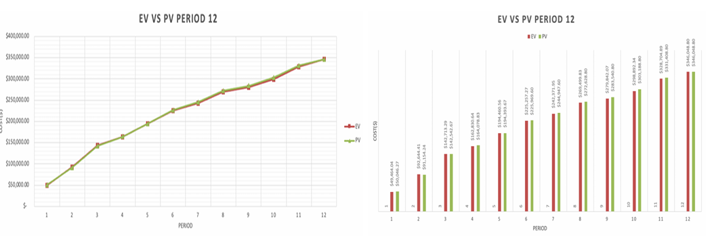
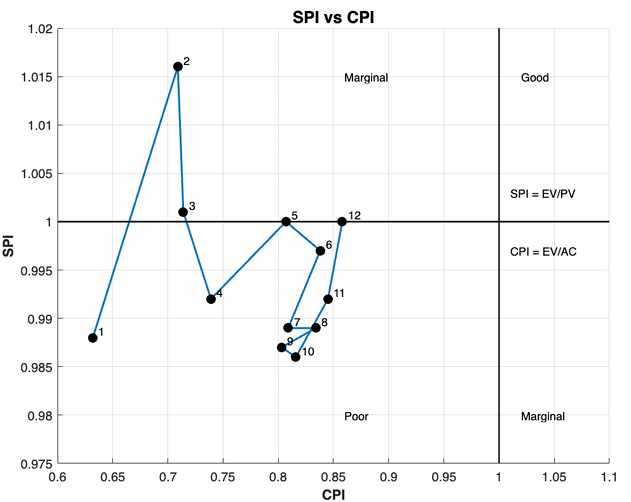
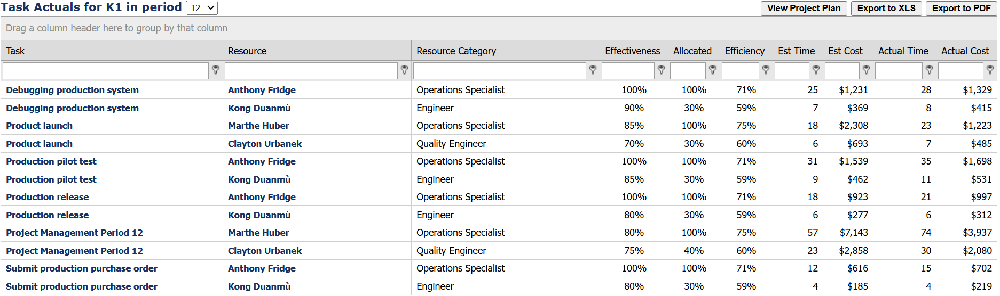
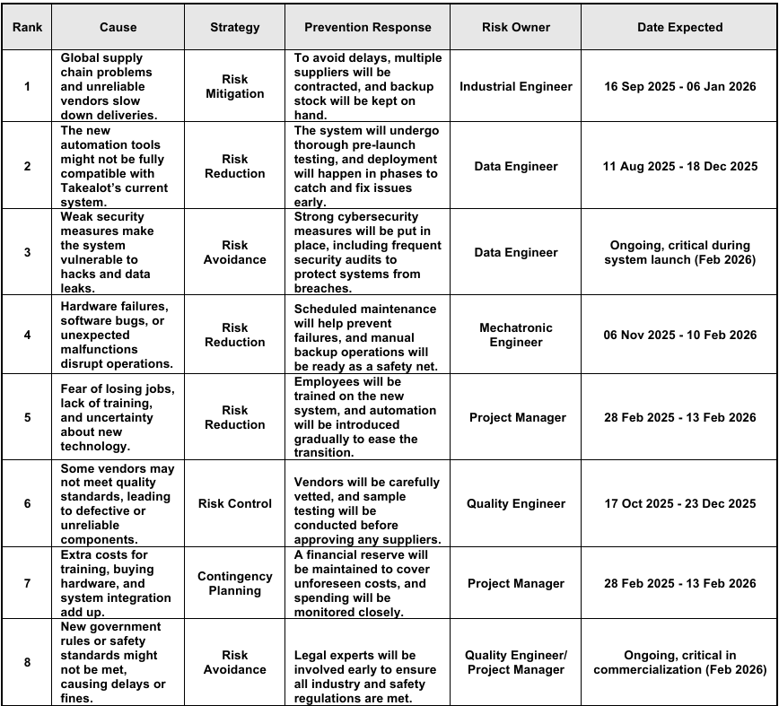
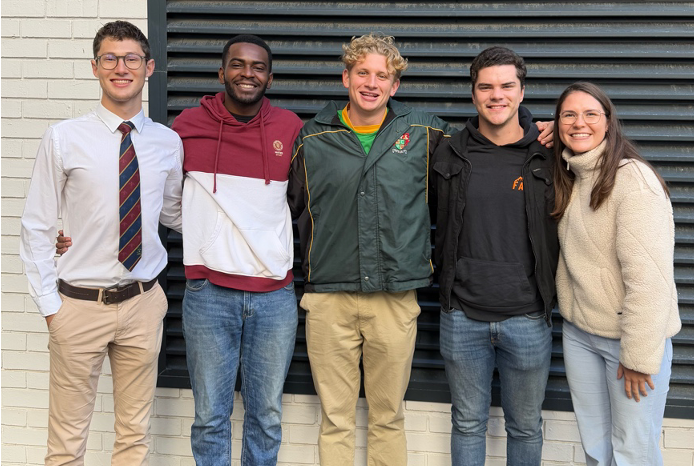

::: {.section}

[← Back to Portfolio](../portfolio.qmd)

# Automated Smart Distribution Warehouse {.section-title}
**Context:** Project Management 412 · Multidisciplinary Simulation (Sim4Projects)

A 12-week academic simulation project replicating the management of a $380,000 warehouse automation initiative.

---

### The Problem
* Competing against 8 other groups to manage a simulated "Takealot warehouse automation" project across 12 live periods, each requiring resource bids, schedule decisions, and budget control with no room to undo mistakes.
* The simulation threw unpredictable, real-world curveballs at the team, including sudden budget cuts, community unrest, and environmental fines.
* Operating within a multidisciplinary team of five engineers, the core challenge was aligning disparate technical perspectives under tight academic deadlines to deliver a highly complex project.

### The Approach
* Built and maintained the full MS Project baseline from the ground up, scheduling all resources and tracking task progress across every period. 
* Applied Industrial Engineering systems-thinking to analyze the cost-effectiveness of each resource role. This led to the strategic decision to replace an expensive Project Manager with trained Operations Specialists and Engineers, saving significant budget.
* Monitored resource efficiency and flagged performance drops early, triggering a corrective intervention for declining engineer efficiency.
* Tracked Earned Value Analysis (EVA) metrics to give the team a data-driven view of cost and schedule performance, enabling faster course correction after a major Period 6 overallocation incident.
* Contributed beyond scheduling by actively driving the team's bidding strategy, critical path prioritization, Risk Management assessments, and Earned Value Analysis.

### The Outcome
* Final project mark: **76%**
* Led the team from an initial 8th-place deficit to a **1st-place overall finish** in our simulation cohort by Period 8, holding that position through to the end.
* Achieved a Cost Performance Index (CPI) improvement from 0.63 to 0.86 over 12 periods.
* Successfully closed out, recovering the schedule to finish only 7 days behind despite the many setbacks.

> **Peer Testimonial:** *"Emmanuel impressed me with his ability to think analytically and his command of scheduling and budgeting. He immediately became familiar to the MS Project environment and played a significant role in helping us allocate our resources as efficiently as possible. During times of stress, his composed and concentrated demeanor served to stabilize the group."* - L. Coetser (Industrial Engineer)

[View Full Report](../images/pm_proj.pdf){.btn-primary}
---

### Project Visuals

**Earned Value Analysis (EVA) & Cost Control**

**Sim4Projects Task & Resource Tracking**

**Risk Management & Prioritization**

**The Multidisciplinary Project Team**

:::