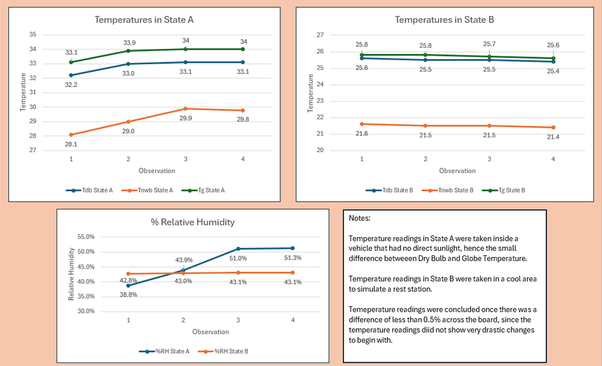
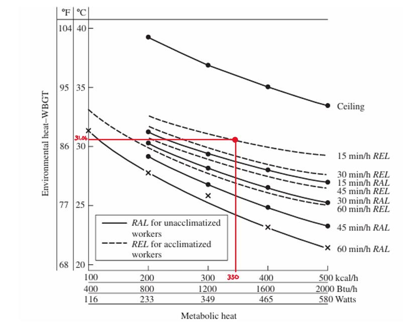
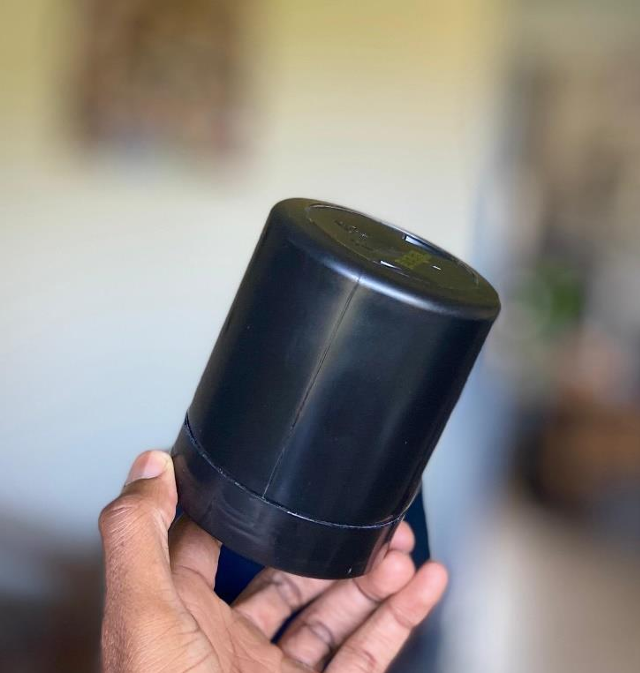

::: {.section}

[← Back to Portfolio](../portfolio.qmd)

# Ergonomics & Thermal Stress Analysis {.section-title}
**Context:** Industrial Ergonomics 414 · ECSA GA2 Project

---

### The Problem
* Thermal stress in hot, humid work environments significantly impacts worker performance, safety, and health, leading to fatigue and reduced efficiency.
* Because ambient conditions cannot always be fully eliminated (e.g., in mobile work contexts like Uber driving), mitigating heat stress requires a multidisciplinary engineering approach.
* The objective was to apply scientific and engineering knowledge from first principles (ECSA GA2) to assess thermal risk and develop practical interventions. 

### The Approach
* Collected environmental data in a simulated hot/humid workspace (State A) and a cooler rest area (State B) using an RSPro IM-730 hygrometer.
* Engineered a DIY black globe thermometer (placing the sensor inside a black cylindrical container) to accurately estimate radiant heat exposure.
* Calculated the indoor Wet Bulb Globe Temperature (WBGT) to quantify the exact level of thermal strain.
* Mapped the environmental data against ergonomic models (Niebel’s Work Design) for a worker producing 350 kcal/hr during seated, moderate arm work.

### The Outcome
* Peak measurements in the simulated workspace revealed a WBGT of 31.06°C.
* Identified that this specific thermal load poses a high risk of heat stress, theoretically requiring a 75% rest allowance which severely limits productivity.
* Recommended targeted interventions, including forced ventilation to enhance convective heat loss and strict, data-driven work-rest cycles.

> **Business Impact:** Demonstrated the ability to physically measure, model, and mitigate environmental constraints that directly impact human operational efficiency and safety compliance.

---

### Project Visuals

**Temperature and Humidity Modeling**

**WBGT Heat Stress Exposure Limit Chart and DIY Globe Thermometer Application**

::: {layout-ncol=2}

:::

---

## Report

[Open Full Report PDF ↗](../images/ergos_report.pdf){.btn-secondary target="_blank" style="margin-left: 0; margin-bottom: 1rem;"}

<iframe src="../images/ergos_report.pdf" width="100%" height="600px" style="border: 1px solid var(--border); border-radius: 8px;"></iframe>

:::
