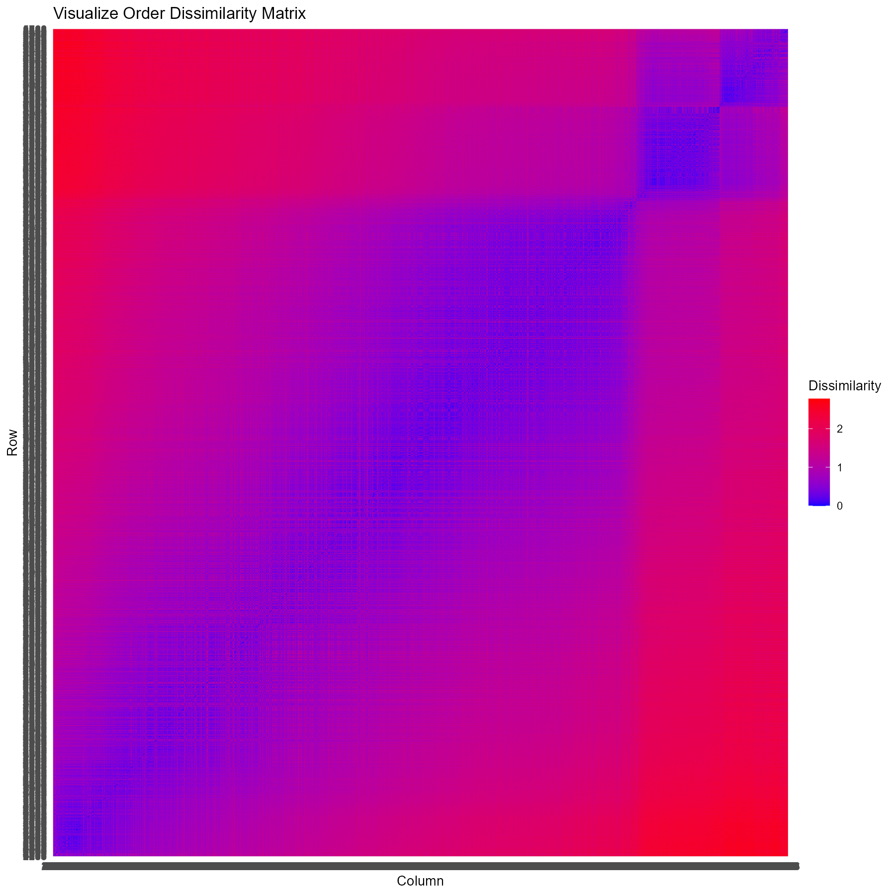
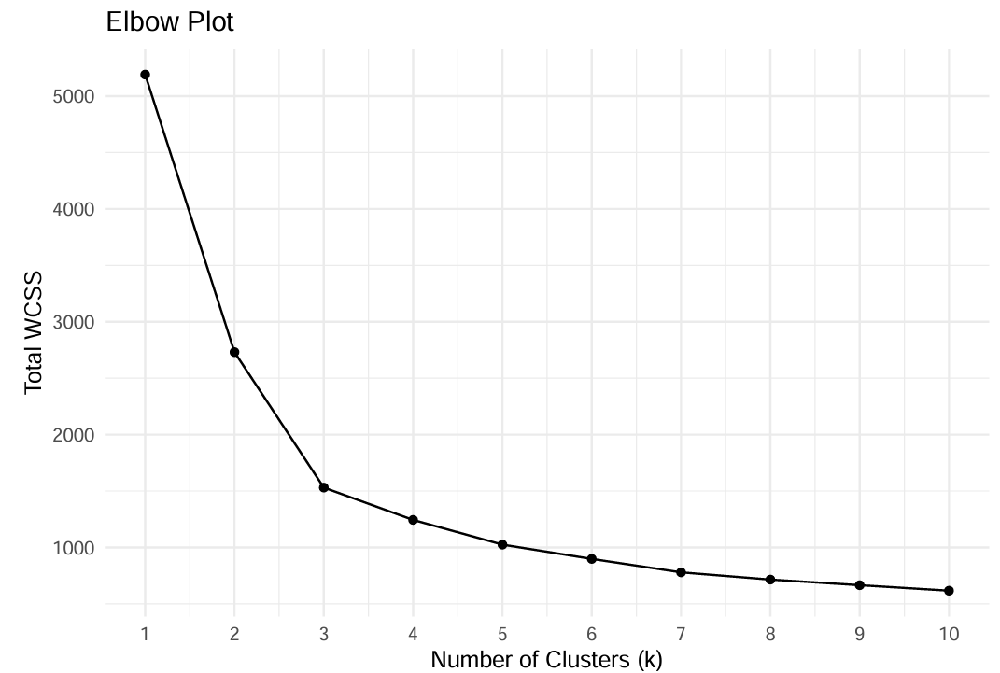
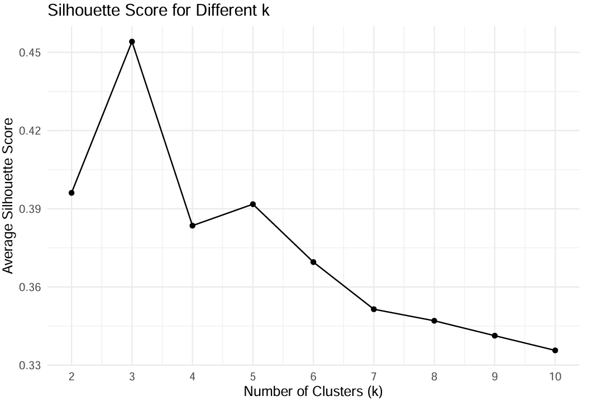

::: {.section}

[← Back to Portfolio](../portfolio.qmd)

# Wind Turbine Operational Analysis & Clustering {.section-title}
**Context:** Data Analytics 344 · R-based Academic Project 

---

### The Problem
- The objective was to discover patterns and groupings in unlabeled 10-minute aggregated sensor recordings from a wind turbine.
- The raw dataset was highly complex, containing 60 different features with varying scales, outliers, and irregularities.

### The Approach
- Conducted exploratory data analysis, handled outliers, and generated Pearson correlation heatmaps to understand feature relationships.
- Trained a 10x10 Self-Organizing Map (SOM) over 300 epochs to identify underlying patterns.
- Used the SOM and a U-Matrix to reduce dimensionality, selecting 10 non-redundant, high-impact features (e.g., PitchAngle, RotorSpeed, Torque).
- Evaluated cluster tendency, achieving a **Hopkins Statistic of 1**.
- Applied K-Means clustering, determining the optimal number of clusters to be 3 via the Elbow Method and Silhouette scores.

### The Outcome
- Final project mark: **96%**
- Successfully segmented the turbine data into three distinct, cohesive operational clusters.
- Demonstrated clear relationships between environmental inputs (wind speed) and mechanical responses.

> **Business Impact:** These clusters can be utilised by site managers to identify abnormal mechanical stress and perform predictive maintenance before component failure, and to analyse correlations between components during high and low stress situations.

[View Full Report](https://drive.google.com/file/d/1Af_g5753pE1WVJoNjmIFcAPKGVsP3Apx/view?usp=drive_link){.btn-primary}

---

### Project Visuals

**Self-Organizing Map (SOM) Feature Activations**

**Visualize Order Dissimilarity Matrix (VODM)**

**Clustering Validation Metrics**

::: {layout-ncol=2}

:::

:::